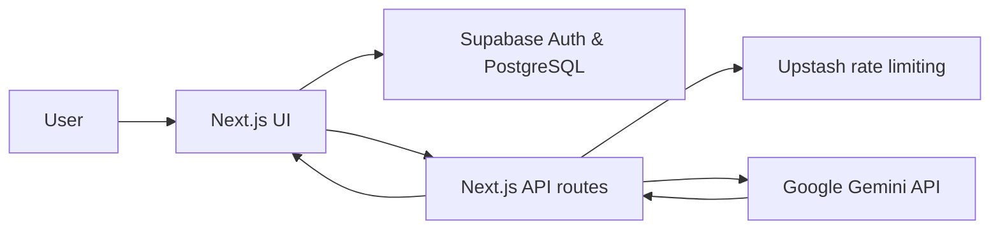

<div align="center">

# ✨ TaskFlow AI

### Plan smarter. Collaborate better. Get things done.

**An AI-powered project management application for organizing workspaces, managing projects, and turning ideas into actionable tasks.**

[**🚀 Live Application**](https://taskflow-ai-v2-five.vercel.app/) · [**💻 Source Code**](https://github.com/Kalyanpatlolla/taskflow-ai-v2)

    

</div>

---

## Overview

TaskFlow AI brings project planning, task management, and AI-assisted workflows into a single dashboard. Create workspaces, organize projects, move tasks through a Kanban board, and generate task suggestions using Google Gemini.

The application is built with **Next.js, TypeScript, Supabase, and Tailwind CSS**, with server-side AI requests and rate limiting.

> **Project status:** Deployed. Production feature verification is in progress.

## Features

| Feature | What it does |
| --- | --- |
| 🔐 **Authentication** | User signup, sign-in, and protected project pages with Supabase Auth |
| 🗂️ **Workspaces & projects** | Organize projects under workspaces and manage project details |
| 📋 **Kanban task board** | Create, edit, and move tasks across workflow stages |
| ✨ **Gemini-powered suggestions** | Generate actionable tasks from project context, then review suggestions |
| 🔔 **Notifications** | In-app notifications and configurable notification preferences |
| 🎨 **Responsive dashboard** | Colorful cards, responsive layouts, and light/dark theme support |
| 🛡️ **Data isolation** | Supabase Row Level Security policies for authenticated project data |

## Tech Stack

| Layer | Technologies |
| --- | --- |
| Frontend | Next.js 16 (App Router), React, TypeScript, Tailwind CSS |
| Backend | Next.js server routes and server-side application logic |
| Authentication & database | Supabase Auth, PostgreSQL, Row Level Security |
| AI | Google Gemini API (`@google/genai`) |
| Rate limiting | Upstash Redis |
| Deployment | Vercel |
| Version control | Git and GitHub |

## How It Works



1. **Authenticate** to access your account and workspaces.
2. **Create a workspace and project** to organize your work.
3. **Manage tasks** through the Kanban workflow.
4. **Ask Gemini for task suggestions** and review the suggested work items.
5. **Monitor updates** through in-app notifications and preferences.

## Getting Started

### Prerequisites

- Node.js and npm compatible with the project's Next.js version
- A Supabase project with the required database migrations applied
- A Google Gemini API key
- An Upstash Redis database (for the configured rate limiter)

### Install

```bash
git clone https://github.com/Kalyanpatlolla/taskflow-ai-v2.git
cd taskflow-ai-v2
npm install
```

### Configure Environment Variables

Create a `.env.local` file at the project root. Use the variable names expected by your version of the source code; the following are examples:

```dotenv
NEXT_PUBLIC_SUPABASE_URL=your_supabase_project_url
NEXT_PUBLIC_SUPABASE_PUBLISHABLE_KEY=your_supabase_publishable_key
GEMINI_API_KEY=your_gemini_api_key
GEMINI_MODEL=your_supported_gemini_model
UPSTASH_REDIS_REST_URL=your_upstash_rest_url
UPSTASH_REDIS_REST_TOKEN=your_upstash_rest_token
```

**Important:** Some Supabase client versions use `NEXT_PUBLIC_SUPABASE_ANON_KEY` or `NEXT_PUBLIC_SUPABASE_PUBLISHABLE_OR_ANON_KEY` instead. Check the imports and environment lookups in the repository, and use the names actually required by the app. Never commit `.env.local` or real secret values.

### Set Up the Database

Apply the SQL schema and migrations required by the application to your Supabase project, including authentication-related Row Level Security policies and notification tables. Review the SQL files in `supabase/migrations/` before applying them.

### Run Locally

```bash
npm run dev
```

Visit **http://localhost:3000**.

### Quality Checks

```bash
npm run lint
npx tsc --noEmit
npm run build
```

## Deployment

The application is hosted on **Vercel**. To deploy your own instance:

1. Import your fork or repository into Vercel as a **Next.js** project.
2. Configure the required environment variables in Vercel's project settings.
3. Deploy the `main` branch.
4. In **Supabase → Authentication → URL Configuration**, configure the production Site URL and allowed auth redirect URLs.
5. Verify signup, sign-in, project CRUD, task management, AI requests, and notifications on the production domain.

## Security & Privacy

- Sensitive API keys belong in **server-side environment variables**, not browser code.
- User access to database records is constrained through Supabase Auth and **Row Level Security**.
- AI requests are handled through backend endpoints with configured rate limiting.
- Secrets, service-role keys, tokens, and `.env.local` files must not be committed to Git.

> The public repository contains source code, not production credentials.

## Project Structure

```text
taskflow-ai-v2/
├── app/                  # Next.js pages, layouts, and API routes
├── components/           # Reusable UI and dashboard components
├── lib/                  # Shared application utilities
├── supabase/
│   └── migrations/       # Database migration scripts
├── public/               # Static assets (if present)
├── .env.example          # Environment variable template
├── package.json
└── README.md
```

## Roadmap

- [x] Project and workspace management
- [x] Kanban task workflows
- [x] Gemini task suggestions
- [x] In-app notifications and preferences
- [x] Redesigned TaskFlow AI v2 interface
- [x] GitHub and Vercel deployment
- [ ] Complete end-to-end production regression tests
- [ ] Add real product screenshots and demo walkthrough
- [ ] Expand automated integration and end-to-end test coverage

## Author

**Kalyan Reddy Patlolla**

[GitHub](https://github.com/Kalyanpatlolla) · [Live Demo](https://taskflow-ai-v2-five.vercel.app/)

---

<div align="center">

**Built to make project planning more organized, intelligent, and efficient.**

</div>
